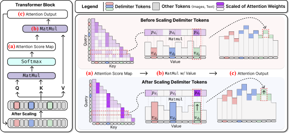
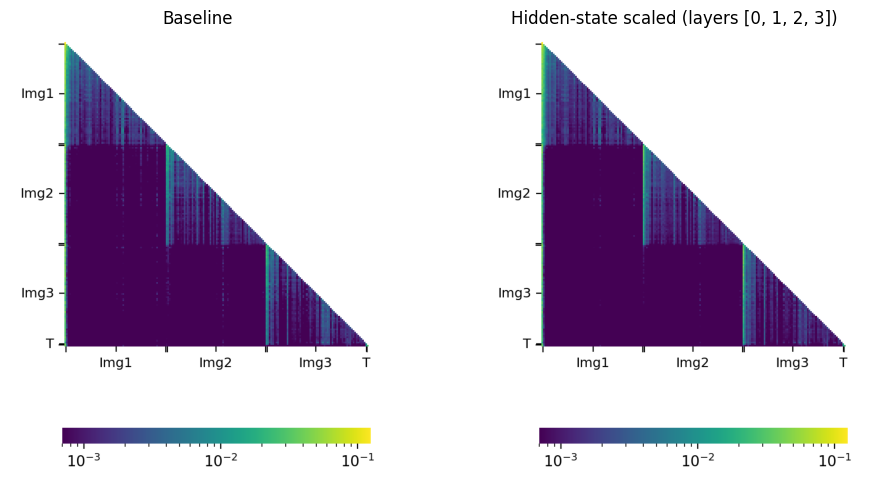

[English](README.md) | 한국어

# 재현: MuirBench 전체 헤드라인 결과

Table 1의 Qwen2.5-VL-3B MuirBench 구분자 스케일링 결과를 공개 테스트 세트 전체 2,600문항에서 검증했습니다. **부분 재현:** 논문 37.31% → 42.42% (+5.11 pp), 로컬 37.00% → 41.19% (+4.19 pp). README의 4-process FlashAttention2/샘플링 경로 대신 로컬 RTX PRO 6000 Blackwell GPU 2장, Python 3.10/PyTorch CUDA 12.8, 비전·언어 SDPA와 블록 단위 비전 어텐션으로 실행했습니다. λ=8/레이어 0–3은 공개 코드의 기준 설정이고 논문의 테스트 10% 튜닝 프로토콜은 재현하지 않았습니다. 자세한 내용: [전체 보고서](reports/delimiter-token-scaling-muirbench/reproduction-report.md).

독립 무결성 검사: 스케일링 샘플에는 고유 문서 ID 2,600개(0–2599)가 모두 들어 있고 정답은 정확히 1,071개입니다. 문항 단위로 짝지은 결과는 개선 277개, 퇴보 168개로 순증 +109입니다.

| 브랜치 / 실험 | 목적 또는 변경 | 실행 명령 | 판정 / 결과 | 연산 자원 |
|---|---|---|---|---|
| `main` | 실험으로 실행하지 않음 (공개용 브랜치) | — | 재현 자료 공개 | — |
| [전체 기준선](https://github.com/mrpc2003/DelimScaling/tree/orx/memory-safe-blockwise-vision-sdpa-baseline) | SDPA/블록 단위 전체 기준선 | `bash reproduction/run_muirbench.sh` | 37.00% (962/2600) | 로컬 2× RTX PRO 6000 Blackwell |
| [스케일링 기준 설정](https://github.com/mrpc2003/DelimScaling/tree/orx/released-code-delimiter-scaling-lambda-8-layers) | λ=8, 레이어 0–3 적용 | `bash reproduction/run_muirbench.sh` | 41.19% (1071/2600), +4.19 pp | 로컬 2× RTX PRO 6000 Blackwell |

# Enhancing Multi-Image Understanding Through Delimiter Token Scaling (ICLR 2026)


저자: [Minyoung Lee](https://sites.google.com/view/minyoung-lee), [Yeji Park](https://yejipark-m.github.io/), [Dongjun Hwang](https://dongjunhwang.github.io/), [Yejin Kim](https://sites.google.com/view/yejin-c-kim/), [Seong Joon Oh](https://coallaoh.github.io/), [Junsuk Choe](https://sites.google.com/site/junsukchoe/)

이 저장소는 ICLR 2026에서 발표된 논문 **["Enhancing Multi-Image Understanding Through Delimiter Token Scaling"](https://openreview.net/forum?id=7QFf05KrOm)**의 코드를 담고 있습니다.


> **초록**: 대규모 시각-언어 모델(LVLM)은 단일 이미지 작업에서는 성능이 높지만 여러 이미지를 입력으로 받으면 성능이 떨어집니다. 주된 원인 하나는 이미지 간 정보 누출(cross-image information leakage)로, 모델이 서로 다른 이미지의 정보를 구분하지 못합니다. 기존 LVLM도 각 이미지의 시작과 끝을 표시하는 구분자 토큰을 쓰지만 분석해 보면 이 토큰만으로는 이미지 간 정보 누출을 효과적으로 막지 못합니다. 구분자 토큰의 효과를 높이기 위해 구분자 토큰의 은닉 상태를 스케일링하는 방법을 제안합니다. 이 방법은 이미지 내부 상호작용을 강화하고 원치 않는 이미지 간 상호작용을 제한해 이미지별 정보를 보존하는 능력을 높입니다. 그 결과 모델은 이미지를 더 잘 구분하고 더 정확하게 추론합니다. 실험에서 Mantis, MuirBench, MIRB, QBench2 같은 다중 이미지 벤치마크의 성능이 올랐습니다. 명확한 구분이 필요한 텍스트 전용 작업에서도 이 방법을 평가했습니다. TQABench, MultiNews, WCEP-10 등 다중 문서·다중 표 이해 벤치마크에서도 성능이 향상됐습니다. 특히 이 방법은 추가 학습이나 추가 추론 비용이 들지 않습니다.



## TODO / 코드 공개 계획

공개를 위해 코드베이스를 정리하고 준비하는 중입니다.
다음 구성 요소를 순차적으로 공개합니다.

- [X] **다중 이미지 이해 평가 코드**  
  (LVLM 추론·평가 파이프라인에 통합한 구분자 토큰 스케일링)

- [X] **LLM 벤치마크 코드**  
  (TQABench, MultiNews, WCEP-10을 포함한 다중 문서·다중 표 벤치마크)

- [X] **시각화 코드**  
  (구분자 토큰의 어텐션 맵과 상호작용 분석)

최종 준비가 끝나면 전체 코드를 공개합니다.


## 설치

### Docker 이미지 받기

```bash
docker pull myelena/delim_scaling:slim
```
### 의존성 설치

컨테이너 안에서:

```bash
git clone https://github.com/MYMY-young/DelimScaling.git
cd DelimScaling

cd transformers
pip install -e .

cd ../qwen-vl-utils
pip install -e .

pip install flash-attn==2.7.4.post1
```

### 평가 실행

```bash
accelerate launch --num_processes 4 --main_process_port 12345 -m lmms_eval \
    --model qwen2_5_vl \
    --model_args pretrained=Qwen/Qwen2.5-VL-3B-Instruct,device_map=cuda,attn_implementation=flash_attention_2 \
    --tasks mantis \
    --batch_size 1 \
    --delim_scaling True \
    --scale 8 \
    --select_layer 0,1,2,3
```

### 주요 인자

- `--model_args pretrained=...` : 사용할 사전학습 모델을 지정합니다. 로컬 경로나 HuggingFace 모델 식별자를 쓸 수 있습니다. 예: `Qwen/Qwen2.5-VL-3B-Instruct`.
- `--tasks` : 평가 작업을 지정합니다. 
- `--delim_scaling` : 구분자 토큰 스케일링을 켭니다.  
- `--scale` : 스케일링 계수.
- `--select_layer` : 스케일링을 적용할 레이어.

## 지원 작업

다중 이미지 이해 벤치마크:

- **[Mantis](https://huggingface.co/datasets/TIGER-Lab/Mantis-Eval)**
- **[Muirbench](https://huggingface.co/datasets/MUIRBENCH/MUIRBENCH)**
- **[MIRB](https://huggingface.co/datasets/VLLMs/MIRB)**
- **[QBench2](https://huggingface.co/datasets/q-future/Q-Bench2-HF/viewer/default/dev)**
## 지원 모델

다중 이미지 이해:

- **[Qwen2.5-VL](https://huggingface.co/Qwen/Qwen2.5-VL-7B-Instruct)**
- **[InternVL3](https://huggingface.co/OpenGVLab/InternVL3-1B-hf)**
- **[LLaVA-OneVision](https://huggingface.co/llava-hf/llava-onevision-qwen2-7b-ov-hf)**

## 시각화

어텐션 맵을 시각화해 구분자 토큰 스케일링의 효과를 직접 확인하는 스크립트를 제공합니다. 이미지 구간별로 기준선과 스케일링 적용 시의 어텐션을 비교합니다.



```bash
cd visualize
python3 attention_visualize.py \
    --dataset mirb --sample-idx 257 --layer 35 \
    --select-layer 0,1,2,3 --scale 8 --res-patches 512
```

### 주요 인자

- `--dataset` : 샘플을 가져올 평가 데이터셋 (`mantis` 또는 `mirb`).
- `--sample-idx` : 시각화할 데이터셋 행 인덱스.
- `--layer` : 어텐션을 시각화할 트랜스포머 레이어 (0부터 시작).
- `--select-layer` : 구분자 토큰 스케일링을 적용할 레이어 인덱스 (쉼표로 구분).
- `--scale` : 구분자 토큰 스케일링 계수.
- `--res-patches` : 이미지 해상도 상한 (28x28 패치 단위).

출력(기준선·스케일링 적용 어텐션 맵과 나란히 비교한 그림)은 기본적으로 `attn_maps/`에 저장됩니다 (`--out-dir`로 변경).

## 감사의 글
코드는 [lmms-eval](https://github.com/EvolvingLMMs-Lab/lmms-eval)과 [Transformer](https://github.com/huggingface/transformers)를 기반으로 합니다.
이 연구를 사용하신다면 위 연구들도 함께 인용해 주세요.

## 인용

이 연구가 도움이 되었다면 다음과 같이 인용해 주세요.

```bib
@inproceedings{lee2026delimscale,
  title={Enhancing Multi-Image Understanding through Delimiter Token Scaling},
  author={Lee, Minyoung and Park, Yeji and Hwang, Dongjun and Kim, Yejin and Oh, Seong Joon and Choe, Junsuk},
  booktitle={Proceedings of the 14th International Conference on Learning Representations},
  year={2026}
}
```
